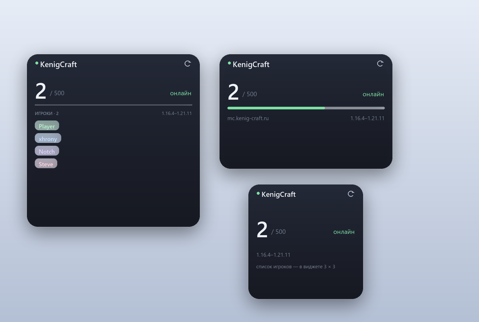

# MC Monitor для Android

Нежный монитор Java- и Bedrock-серверов Minecraft для главного экрана и не только.
Показывает онлайн, версию и список игроков, умеет держать несколько серверов
и добавлять виджеты трёх размеров.

**Файл локальной тестовой сборки: [`MC-Monitor.apk`](MC-Monitor.apk)**



---

## Что умеет

- **Список серверов.** Добавляй по IP или домену, можно с портом: `play.example.com:25566`.
- **Поиск в реальном времени.** Иконка лупы раскрывает строку поиска по серверам и кэшированным никам; кнопка поиска на клавиатуре открывает каталог серверов и игроков сообщества.
- **Группы и приоритетные игроки.** Группируй серверы и настрой уведомления о входе/выходе выбранных игроков.
- **Имя сервера само.** Если не задать имя вручную, приложение вытащит его из MOTD
  (первая строка до `|`).
- **Онлайн всегда на виду.** Большая цифра онлайна, `/ max`, статус и версия.
- **Список игроков прямо в карточке.** Ники в виде мягких чипсов, до 30 штук,
  остальные схлопываются в «+N ещё».
- **Меню ⋮ на каждой карточке:** «Изменить», «Добавить виджет», «Удалить».
- **Иконка сервера** — favicon сервера, если API его отдаёт.
- **Автообновление** раз в 60 секунд, пока приложение открыто.
- **Три виджета:** 2×1, 2×2 и 3×3. В компактном 2×1 крупный онлайн расположен по центру;
  в 2×2 и 3×3 отображаются игроки.
- **Общий аккаунт:** синхронизация списка серверов с ПК-версией и другими
  телефонами; без входа приложение продолжает работать локально.

## Виджеты

| Размер | Что внутри |
|--------|------------|
| **2 × 1** | Название сервера и крупный онлайн по центру |
| **2 × 2** | Онлайн, статус и компактный список игроков |
| **3 × 3** | Полный статус, адрес, время проверки и расширенный список ников |

- Стрелка ↻ в углу виджета обновляет данные вручную.
- Виджеты обновляются в фоне примерно раз в 30 минут через системный
  `JobScheduler` при наличии сети, в том числе после перезагрузки телефона.
- Нажатие на виджет открывает приложение.
- Цвет акцента и фона, а также отображение названия, игроков, версии и времени
  настраиваются отдельно в разделе «Настройки» и применяются ко всем виджетам.

### Как добавить виджет

**Способ 1 — из приложения (удобнее):**
нажми ⋮ у нужного сервера → «Добавить виджет» → выбери размер → подтверди
закрепление на главном экране. Виджет сразу привяжется к этому серверу.

**Способ 2 — через лаунчер:**
зажми пустое место на главном экране → «Виджеты» → найди **MC Monitor** →
выбери 2×1, 2×2 или 3×3.

- Если лаунчер не поддерживает закрепление из приложения, покажется подсказка
  со вторым способом — это нормально.
- Виджет, добавленный через лаунчер, подхватит первый сервер из списка.
  Чтобы привязать конкретный сервер, добавляй через меню ⋮.
- Если сервер в приложении переименовать/сменить адрес, привязанные виджеты
  переедут на новый адрес автоматически.

## Аккаунт и синхронизация

Кнопка «Аккаунт» в верхней части экрана позволяет создать аккаунт или войти:
список серверов сохраняется локально и синхронизируется с ПК-версией и другими
устройствами. При первом входе локальные и облачные серверы объединяются;
смена аккаунта не смешивает списки разных пользователей. Группы, приоритетные
ники и признак показа сервера в виджете синхронизируются вместе со списком.

Профиль позволяет задать отображаемое имя и описание, загрузить аватар, искать
игроков и серверы, подписываться на игроков. Публичный список серверов выключен
по умолчанию: адреса появятся в поиске только после явного включения публикации
в профиле.
Перелистывание группы внутри Android-виджета также пока не поддерживается.
Оформление приложения и виджетов хранится локально и между устройствами не
синхронизируется.

Для бесплатной настройки проекта Supabase см. [инструкцию в репозитории ПК](https://github.com/skyk0l/mc-monitor-pc/blob/main/SUPABASE_SETUP.md)
и запусти оба SQL-файла в указанном порядке. В настройках Supabase нужно отключить
подтверждение email, так как вход выполняется по никнейму. Никнейм — 3–16
латинских букв, цифр или `_`; пароль — не короче 8 символов. Без email
восстановить забытый пароль нельзя.

## Установка APK

1. Скачай последнюю версию APK со страницы [GitHub Releases](https://github.com/skyk0l/mc-monitor-android/releases/latest)
   или перекинь `MC-Monitor.apk` на телефон.
2. Открой файл на телефоне.
3. Android спросит про установку из неизвестного источника — разреши
   для файлового менеджера/браузера, из которого открываешь.
4. Готово. Список серверов изначально пустой: добавь свой сервер вручную
   или войди в аккаунт, чтобы загрузить список из облака.

APK подписан debug-ключом: он пригоден для установки и обновления поверх
предыдущего APK с тем же сертификатом, но Google Play такой файл не примет.
Сборки из GitHub Actions предназначены для тестов; устанавливай APK из Releases.
Для Google Play и официальной release-подписи нужен отдельный ключ.

**Требования:** Android 8.0 (API 26) и выше. Интернет обязателен.
Используются `INTERNET` и `RECEIVE_BOOT_COMPLETED` (обновление виджетов после
перезагрузки); Android 13+ также запрашивает разрешение уведомлений, когда
сохраняются приоритетные игроки.

## Откуда данные

Два публичных статус-API, без ключей и регистрации:

1. [`api.mcstatus.io`](https://mcstatus.io) — основной: аккуратные имена,
   версия, иконка.
2. [`api.mcsrvstat.us`](https://mcsrvstat.us) — запасной, если первый не ответил.

Запросы идут по HTTPS. Последний статус кэшируется, поэтому при открытии
приложения и после перезагрузки данные видны сразу, ещё до свежего запроса.

**Ограничение:** серверы за Velocity-прокси пока нельзя добавить в приложение.

## Структура проекта

```
mc-monitor-apk/
├─ MC-Monitor.apk          готовый APK
├─ preview.png             превью всех трёх виджетов
├─ build-apk.bat           сборка одной кнопкой (Windows)
├─ app/src/main/java/com/mcmonitor/app/
│  ├─ MainActivity.java        экран со списком серверов, диалоги, закрепление виджетов
│  ├─ MinecraftApi.java        запросы к статус-API и разбор ответов
│  ├─ ServerEntry.java         модель сервера, нормализация адреса
│  ├─ ServerStatus.java        модель статуса
│  ├─ ServerStore.java         хранение списка серверов (SharedPreferences)
│  ├─ CloudSyncClient.java     Supabase Auth и синхронизация списка серверов
│  ├─ AccountSessionStore.java шифрованное хранение сессии через Android Keystore
│  ├─ StatusCache.java         кэш последнего статуса
│  ├─ WidgetStore.java         привязка «id виджета → сервер + размер»
├─ WidgetSettingsStore.java настройки цветов и данных виджетов
├─ SettingsActivity.java    отдельный экран настроек
│  ├─ WidgetUpdater.java       отрисовка всех виджетов
│  ├─ WidgetJobService.java    надёжное фоновое обновление виджетов
│  ├─ BaseWidgetProvider.java  общая логика провайдеров
│  ├─ Widget2x2Provider.java   провайдеры трёх размеров
│  ├─ Widget2x1Provider.java
│  ├─ Widget3x3Provider.java
│  ├─ PinResultReceiver.java     результат закрепления виджета
│  ├─ WidgetRefreshReceiver.java кнопка ↻
│  ├─ BootReceiver.java          обновление после перезагрузки
│  ├─ FlowLayout.java            контейнер чипсов с переносом строк
│  └─ BackdropView.java          градиентный фон приложения
└─ app/src/main/res/       layout, drawable, значения, иконки, превью
```

Всё нативное: Java + XML + системные API. Без AndroidX, Compose и сторонних
библиотек — поэтому APK такой маленький.

## Сборка из исходников

Нужны **JDK 17** и **Android SDK** (platform 35, build-tools 35.0.0).

```bat
build-apk.bat
```

Скрипт сам подставит `JAVA_HOME`, соберёт debug-APK и положит его рядом
как `MC-Monitor.apk`. Если JDK/SDK лежат в других местах — поправь пути
в начале `build-apk.bat`.

Или вручную:

```bat
set JAVA_HOME=C:\Users\<ты>\AppData\Local\MoonForgeBuild\jdk-17
set PATH=%JAVA_HOME%\bin;%PATH%
gradlew.bat assembleDebug
```

Результат: `app\build\outputs\apk\debug\app-debug.apk`.

> В проекте включён `android.overridePathCheck=true` в `gradle.properties`:
> путь содержит кириллицу («Проект по умолчанию»), а AGP по умолчанию такую
> папку не переваривает.

Проверка кода и ресурсов:

```bat
gradlew.bat lintDebug
```

## Что осталось за кадром

- Проверка на живом телефоне/эмуляторе не делалась — на машине не было
  ни устройства, ни эмулятора. Код собран и проверен линтом, но первый запуск
  стоит посмотреть глазами.
- Разбивка игроков по режимам сервера — см. ограничение выше.
